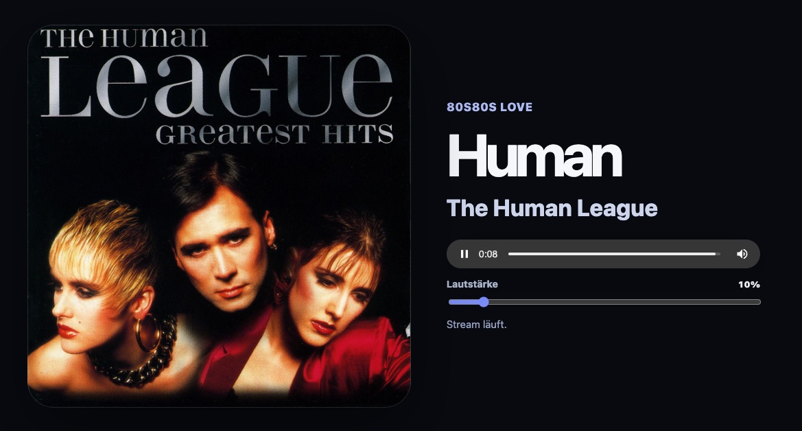
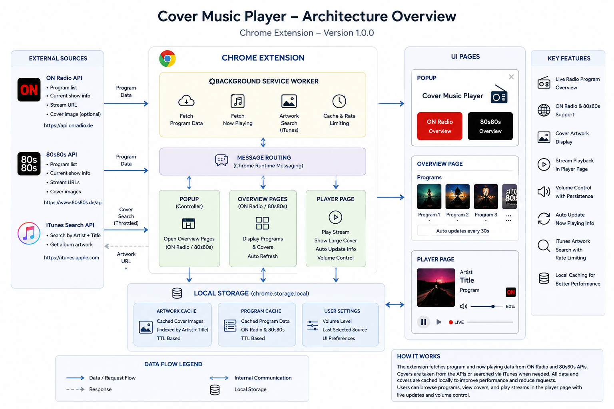
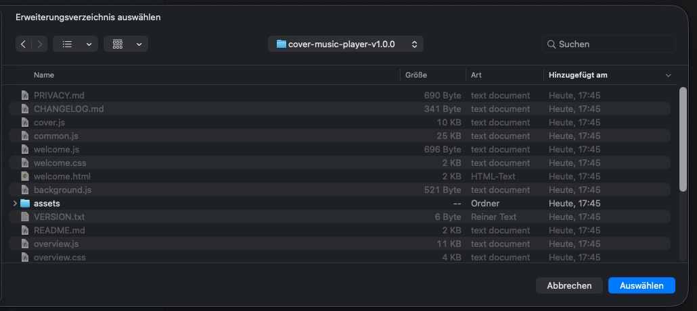
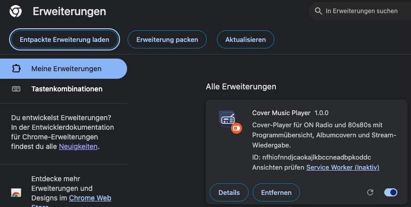
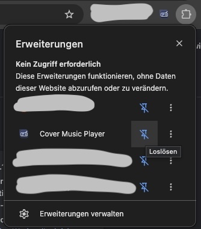
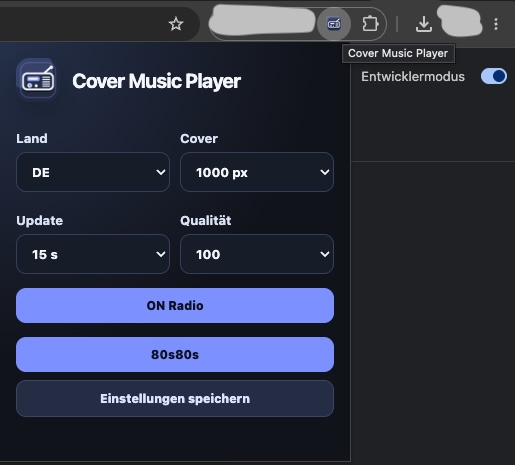
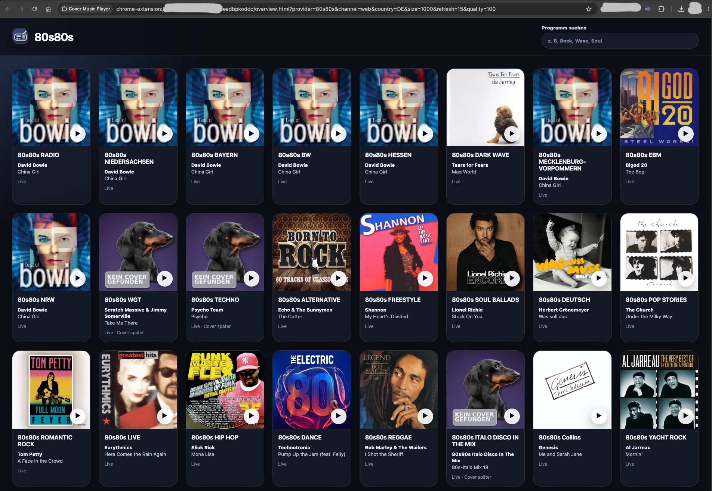
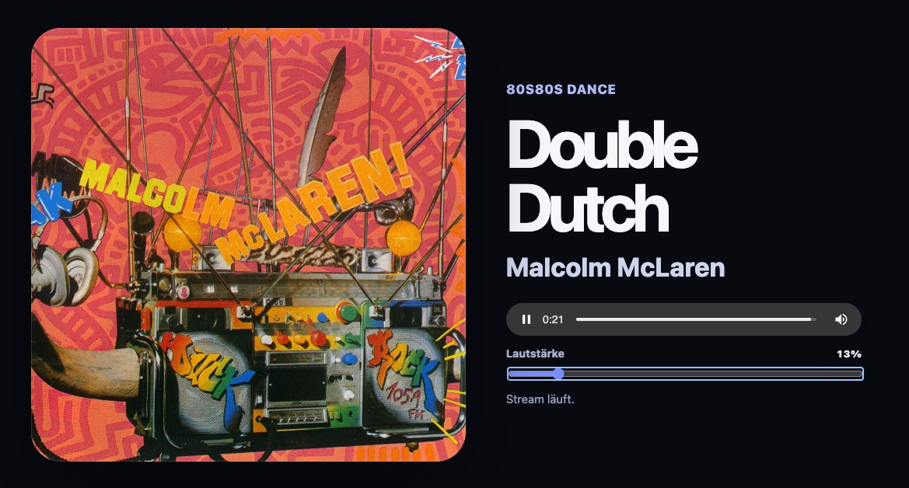

# Cover Music Player

[🇩🇪 Deutsch](README.md) · 🇬🇧 English



Chrome extension for ON Radio and 80s80s. The extension shows program overviews with album covers and, with one click, opens a player tab with a large cover, stream playback and a volume control.

Version **1.0.0** includes:

* ON Radio program overview
* 80s80s program overview
* Clickable cover tiles
* Player tab with large cover artwork
* Integrated audio stream playback
* Volume control with saved volume setting
* Automatic title and cover updates
* Fallback image when no cover is available
* Local cover caching and throttled artwork requests

<br>
<a href="https://www.buymeacoffee.com/thoralf.brandt" target="_blank">
  
</a>
<br>

## Features

- Popup with two starting points: **ON Radio** and **80s80s**
- Separate overview page per provider
- Clicking a cover opens the player tab
- Player with large cover, title, artist, stream and volume control
- Small preview covers in the overview, large covers in the player
- Local fallback image when no cover is found
- Local cache for cover lookups
- Throttled iTunes requests for ON Radio
- Cover and stream data directly from the 80s80s API
- Fixes typical umlaut/encoding errors
- One-time help page for pinning the extension icon



## Installing in Chrome

1. Download and unzip the release from the folder, or download or clone the repository.
2. Open Chrome and go to `chrome://extensions`.
3. Turn on Developer mode.
4. Click **Load unpacked**.
5. Select the folder of this repository.
6. Pin the radio icon via the puzzle menu.













## Data sources

### ON Radio

- Now-playing data and stream URLs: `https://www.0nradio.com/now_playing/<slug>.json`
- Cover search: iTunes Search API
- Cover images: Apple `mzstatic.com`

### 80s80s

- Program list, titles, covers and stream URLs: `https://www.80s80s.de/streams/api`

## Privacy

The extension needs no server of its own and does not send any personal data to the developer. It only loads the data needed to work from ON Radio, 80s80s and the iTunes Search API. Settings, volume and the cover cache are stored locally in Chrome storage.

## Repository structure

```text
manifest.json       Chrome Manifest V3
popup.*             Popup with provider buttons and settings
overview.*          Program overviews with cover tiles
cover.*             Player tab with cover, stream and volume
channels.js         ON Radio program list and provider configuration
common.js           Shared functions for data fetching, covers and encoding
background.js       One-time start page after install or update
welcome.*           Help page for pinning the extension
icons/              Extension icons
assets/             Fallback image for missing covers
```

## Building a release

```bash
zip -r cover-music-player-v1.0.0.zip . -x "*.git*" -x "*.DS_Store" -x "*.zip"
```

## Version

Current version: **1.0.0**
